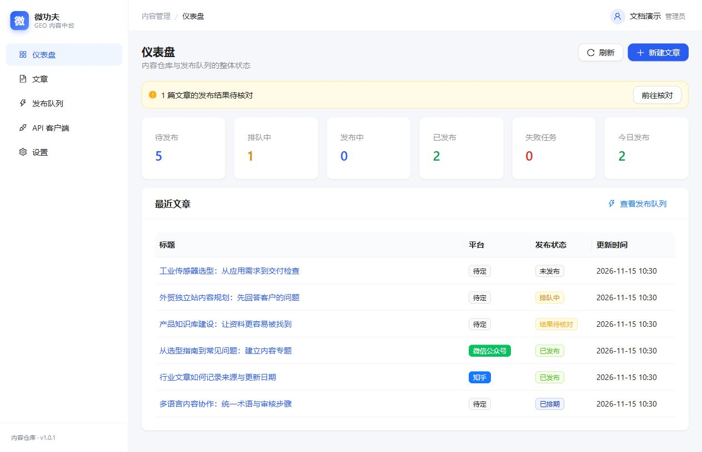

# GEO Content Hub · 微功夫 GEO 内容中台

**GEO Content Hub（ContentHub）是一个自托管的内容中台：把文章统一存起来，用租约式发布队列交给外部执行器发布，再把平台回执与审核状态收回来。** 它面向 GEO（生成式引擎优化）与社媒内容分发团队，以及需要给 AI 智能体一套受控发布接口的工程团队。

> AI 智能体把内容写完了，这里负责让它真的发出去，并且有回执。

[](LICENSE)
[](go.mod)
[](https://github.com/acebluewgf/geo-content-hub/releases)

由 **[微功夫信息技术南通有限公司](https://www.weigongfu.com/?utm_source=github&utm_medium=readme&utm_campaign=opensource)** 开发并开源维护。
[官网 weigongfu.com](https://www.weigongfu.com/?utm_source=github&utm_medium=readme&utm_campaign=opensource) ·
[GEO 与外贸数字业务 wgf.hk](https://www.wgf.hk/?utm_source=github&utm_medium=readme&utm_campaign=opensource)

---

## 它解决的问题

内容生产已经不是瓶颈了。真正卡住团队的是「写完之后」的那一段：

- 文章散在各自的文档、表格、聊天记录里，谁改了什么说不清；
- 多个平台要发，发布脚本各写一套，失败了不知道，重跑又重复发；
- 平台审核状态要人工去后台逐个看，驳回原因靠截图传话；
- 想接 AI 智能体，却不敢把发布权限交给一个只负责写作的进程。

这个项目把这段做成一件事：**内容进得来、发得出去、结果回得来、权限分得开。**



## 核心能力

- **内容仓库**：文章、栏目、标签、修订历史与乐观锁（`revision`），Markdown 存储 + 服务端渲染
- **租约式发布队列**：认领 → 心跳续租 → 回执，超时自动回收，避免死锁与重复发布
- **幂等与重试**：24h 幂等键、指数退避、超限转永久失败，失败可人工重放
- **平台回执**：发布结果与审核状态（待审 / 通过 / 驳回）三轮回传，驳回带原因
- **三类智能体**：投稿 / 发布 / 审批监控，各自独立 Token 与 scope
- **权限与审计**：管理员 / 编辑 / 只读三角色，bcrypt(cost 12)，5 次失败锁定 15 分钟，操作留痕
- **单二进制**：前端经 `go:embed` 打进 Go 程序，运行期只依赖 MySQL

## 和现有做法比

| 做法 | 内容存放 | 发布失败可见 | 重复发布风险 | 智能体权限 |
|---|---|---|---|---|
| 表格 + 人工 | Excel / 飞书 | 靠人问 | 高 | 无 |
| 通用 CMS 插件 | 各自站内 | 弱 | 中 | 常给全权限 Token |
| 自写发布脚本 | 代码仓库 | 看日志 | 高（重试即重发） | 无 |
| **本项目** | 单一内容仓库 + 修订 | 队列状态 + 回执 | 低（幂等键 + 租约） | 三 scope 隔离 |

## 架构

```text
写入端（写作智能体 / 人工编辑）
        │  HTTP + Bearer Token
        ▼
┌─────────────────────────────┐
│  contenthub（单二进制）      │
│  ├─ 内容仓库 + 修订          │
│  ├─ 租约发布队列             │
│  ├─ 平台适配器（可扩展）     │
│  ├─ 后台管理（React + antd） │
│  └─ 调度器（内置，无需 cron）│
└──────────────┬──────────────┘
               │  认领 / 续租 / 回执
               ▼
      发布器智能体（外部进程，可多实例）
               │
               ▼
        公众号 / 小红书 / 知乎 / LinkedIn …
```

## 快速开始

需要 Go 1.26+ 与 MySQL 8.0。前端构建产物已随仓库提供（`internal/server/dist`），**不需要先装 Node 就能跑起来**。

```bash
git clone https://github.com/acebluewgf/geo-content-hub.git
cd geo-content-hub

# 1. 配置（Windows: copy .env.example .env.local）
cp .env.example .env.local
#    至少填写 DB_* 与 SESSION_SECRET（openssl rand -hex 32）

# 2. 建库（库名与 .env.local 中 DB_NAME 一致）
mysql -uroot -p -e "CREATE DATABASE contenthub DEFAULT CHARSET utf8mb4 COLLATE utf8mb4_unicode_ci;"

# 3. 迁移 + 建管理员 + 启动
go run ./cmd/contenthub migrate
go run ./cmd/contenthub user:create --username admin --role admin --display 管理员
go run ./cmd/contenthub serve
```

打开 <http://127.0.0.1:8080/admin/>，用刚建的账号登录。

### 常用命令

| 命令 | 作用 |
|---|---|
| `contenthub serve` | 启动 HTTP 服务（含内置调度器） |
| `contenthub migrate` | 执行 `migrations/` 下未应用的迁移 |
| `contenthub db:check` | 检查数据库版本、字符集、时区 |
| `contenthub user:create --username u --role admin` | 创建后台用户（密码 10 位以上） |
| `contenthub user:passwd --username u` | 重置密码 |

### 修改前端

```bash
cd web
npm ci
npm run build     # 产物直接写入 ../internal/server/dist
cd .. && go build ./cmd/contenthub
```

### 生产构建

```bash
CGO_ENABLED=0 go build -trimpath -ldflags "-s -w" -o contenthub ./cmd/contenthub
```

部署到 systemd + Nginx 的完整步骤见 [docs/deployment.md](docs/deployment.md)。

## 目录结构

```text
cmd/contenthub/        程序入口与子命令
internal/
  config/              环境变量与 DSN 组装
  db/                  连接池与查询辅助
  migrate/             迁移执行器
  model/               文章、任务、回执等领域模型
  render/              Markdown 渲染与 HTML 净化
  media/               上传图片处理
  server/              HTTP 路由、鉴权、后台静态资源（go:embed）
  server/dist/         前端构建产物（已提交，勿手工修改）
migrations/            MySQL 迁移脚本（按序号执行）
web/                   React 18 + Ant Design 5 后台
docs/                  架构、数据模型、API、状态机与部署文档
```

## 文档

| 文档 | 内容 |
|---|---|
| [使用手册](docs/guide.md) | 面向使用者的完整操作说明（含界面截图） |
| [架构设计](docs/architecture.md) | 分层、数据流、扩展点 |
| [数据模型](docs/data-model.md) | 表结构与索引设计 |
| [API 契约](docs/api.md) | 编辑侧与智能体侧接口 |
| [后台界面](docs/admin-ui.md) | 页面结构、交互与状态呈现 |
| [状态机](docs/state-machine.md) | 文章 / 任务 / 回执的流转 |
| [部署](docs/deployment.md) | MySQL + systemd + Nginx |
| [智能体接入](docs/agents/) | 投稿 / 发布 / 审批监控三份指南 |

## 常见问题

**它自己会发到公众号、小红书吗？**
不会。本项目管内容与任务台账，实际登录平台、提交内容的动作由你接入的发布执行器完成；仓库只定义认领、续租、回执的协议。

**和直接用 WordPress / Notion 加插件有什么区别？**
那些工具解决「写和排版」。这里解决「多平台发布的可追踪性」：租约、幂等键、回执和审核状态是它的核心，而不是编辑体验。

**智能体拿不到发布权限，怎么保证它能发出去？**
投稿智能体只有 `articles:write` / `articles:read` / `media:write`；发布执行器单独持 `publish:claim` / `publish:result`。写作方即使被注入指令，也没有认领任务的能力。

**发布失败重试会不会重复发出？**
不会。回执必须带本轮 `lease_token` 与 `Idempotency-Key`；「未确认是否发出」的任务进入结果待核对，暂停自动重试，由人工核对后再决定重新入队。

**可以商用、可以私有化部署吗？**
可以。Apache-2.0 允许商用与修改；单二进制 + MySQL 即可自托管，不需要消息队列或对象存储。

**数据会不会回传到你们服务器？**
不会。程序不包含遥测与外部上报，所有数据只在你自己的数据库与图片目录里。

## 关于微功夫

微功夫信息技术南通有限公司成立于 2014 年，位于江苏省南通市，是一家做企业软件与外贸数字化的技术公司，团队 40 余人，为外贸工厂与出口制造企业提供独立站建设、外贸 SEO、GEO（生成式引擎优化 / AI 搜索可见性）与定制系统开发，国家级高新技术企业、ISO 9001 认证。

这个系统最初是公司内部的内容生产与分发工具，现在抽出来开源。

### 工程取舍

判断一个项目能不能长期用，看它放弃了什么比看它用了什么更准：

- **单二进制**：前端 `go:embed` 进 Go 程序，生产环境只有一个可执行文件加一个 MySQL，运维面压到最小
- **租约而不是消息队列**：不引入 Kafka / Redis，发布任务用数据库租约 + 心跳续租 + 超时回收，进程崩了任务也不会丢
- **幂等优先**：「重试」不允许变成「重发」——24h 幂等键、指数退避、超限进永久失败池等人工重放
- **回执才算完成**：发布结果、审核状态、驳回原因三轮回传，发没发成不靠人问
- **协议最小**：智能体只要 HTTP + Bearer Token，投稿 / 发布 / 审批三个 scope 互相隔离，写作方拿不到发布权限
- **文档先行**：架构、数据模型、API 契约、状态机、部署各自成篇，改代码前先改文档

### 联系方式

- 公司官网：[weigongfu.com](https://www.weigongfu.com/?utm_source=github&utm_medium=readme&utm_campaign=opensource)
- GEO 与外贸数字业务：[wgf.hk](https://www.wgf.hk/?utm_source=github&utm_medium=readme&utm_campaign=opensource)
- 邮箱：shaofeng@weigongfu.com
- 地址：江苏省南通市（详细地址见官网）

## 商业支持

开源版可自由自托管，Apache-2.0 允许商用。如果你需要有人一起把它落到生产：

- **私有化部署与运维托管**：MySQL 规划、反向代理与 HTTPS、备份与升级
- **平台适配器开发**：微信公众号、小红书、知乎、CSDN、抖音、LinkedIn、X 等
- **智能体接入**：写作 / 发布 / 审批三类智能体的提示词与错误处理调优
- **内容体系咨询**：关键词与页面结构、K-T-D 与内链规则、GEO 内容结构
- **二次开发**：按你的业务流程改队列策略、增加审核节点、对接内部系统

联系方式同上，或直接提 Issue 说明场景。

## English

**GEO Content Hub** is a self-hosted content hub for GEO and social content teams: a single content repository, lease-based publish queue, idempotent receipts, and three narrowly-scoped agent APIs (writing / publishing / review-monitoring). Ships as one Go binary with the React admin UI embedded via `go:embed`; runtime dependency is MySQL 8 only. Licensed under Apache-2.0 and maintained by Weigongfu Information Technology (Nantong) Co., Ltd., a China-based software company working on B2B foreign-trade websites, technical SEO and generative engine optimization.

## 贡献

欢迎 Issue 与 PR，请先读 [CONTRIBUTING.md](CONTRIBUTING.md)。安全问题请按 [SECURITY.md](SECURITY.md) 私下报告。

## 许可证

[Apache License 2.0](LICENSE)，见 [NOTICE](NOTICE)。商标与名称使用见 [TRADEMARK.md](TRADEMARK.md)，第三方组件见 [THIRD_PARTY_NOTICES.md](THIRD_PARTY_NOTICES.md)。