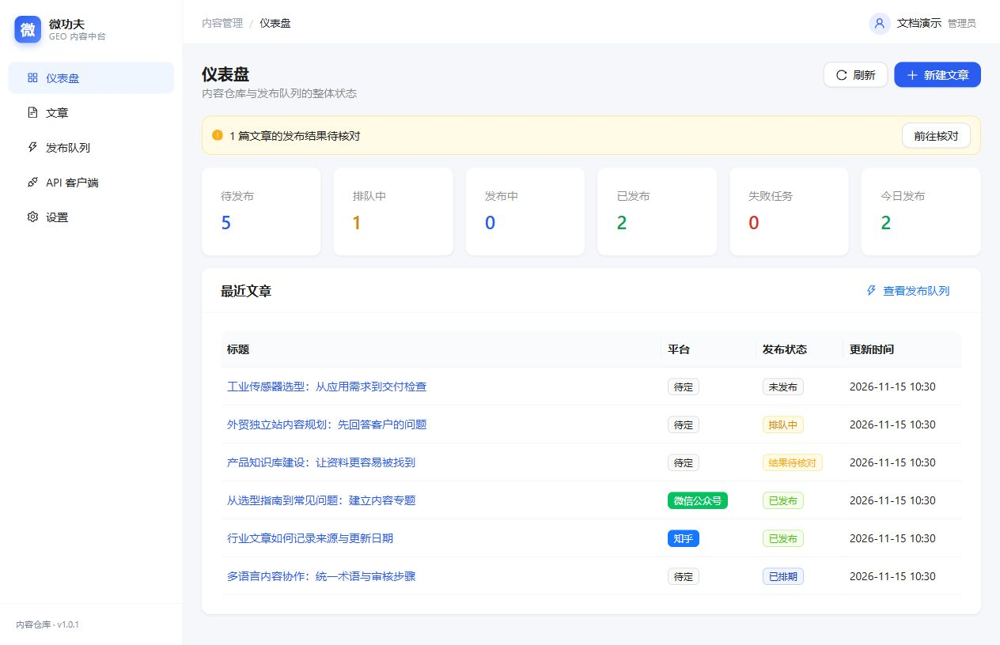
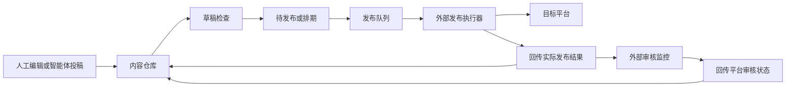
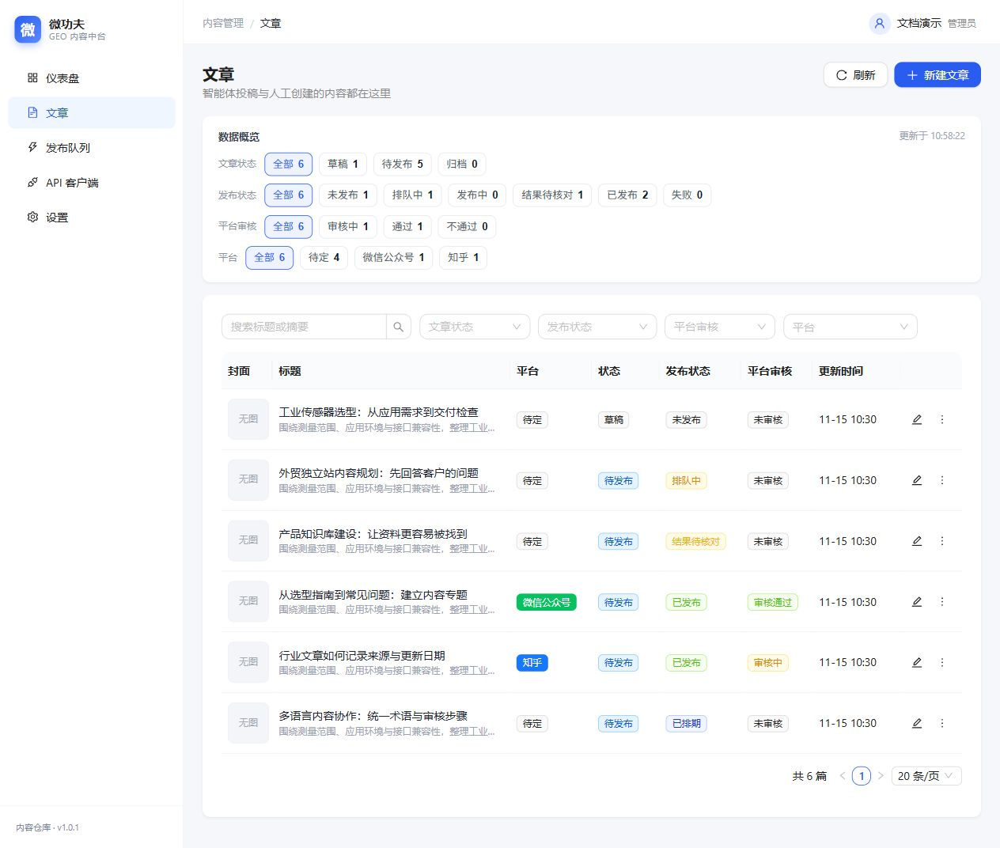
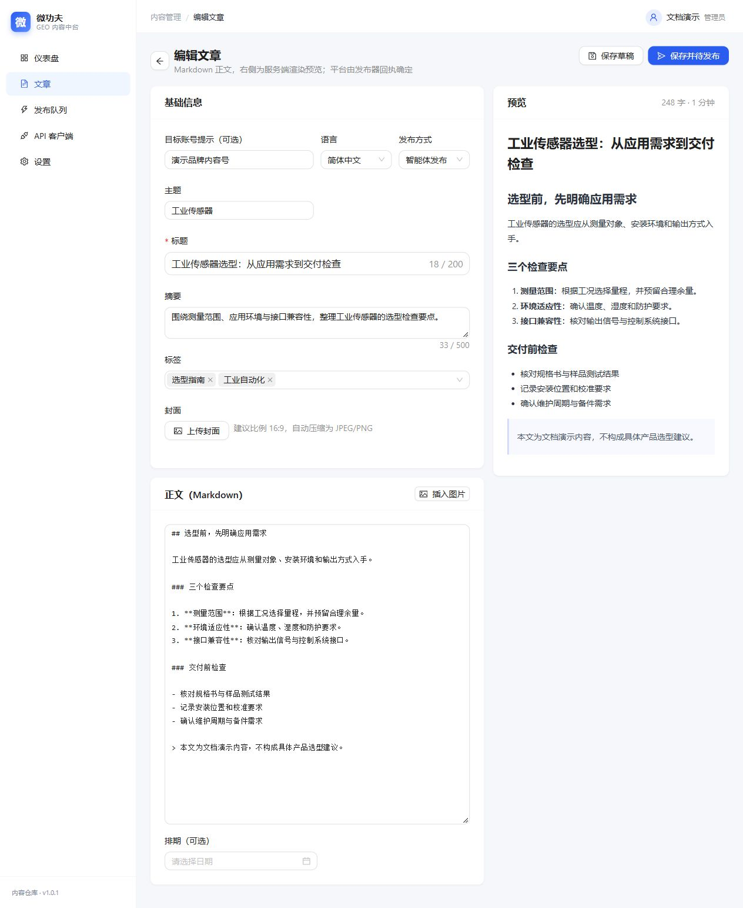
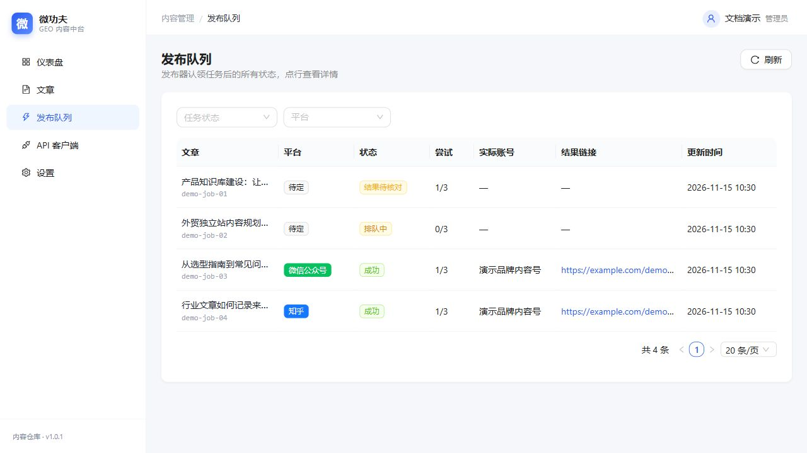
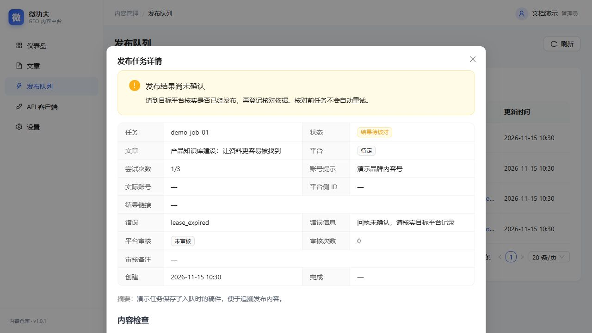
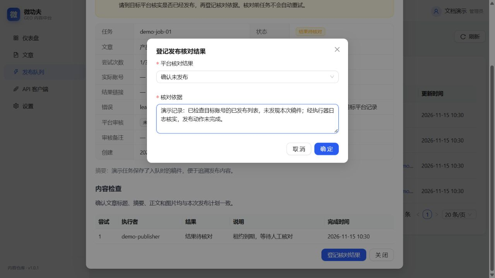
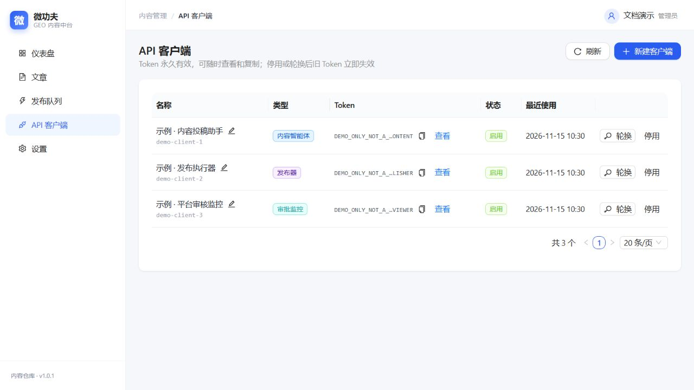
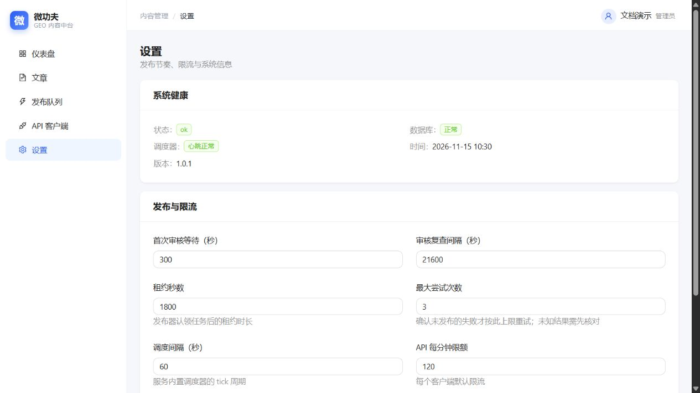
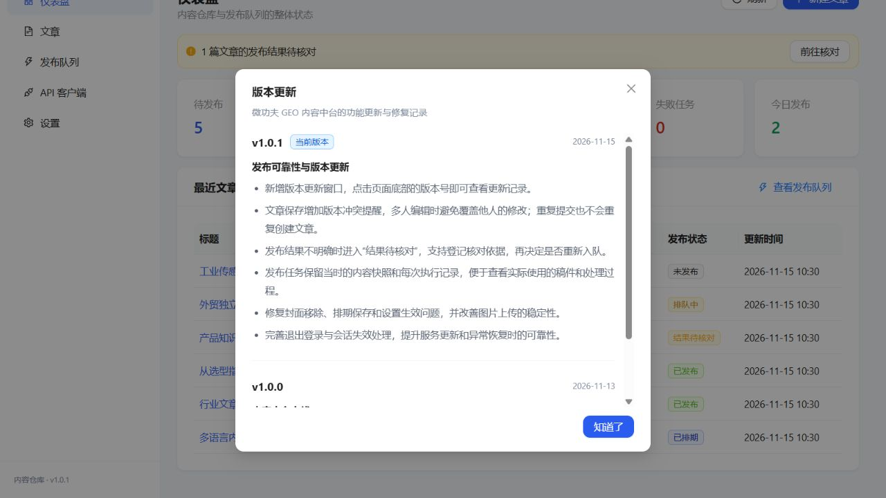

# 使用手册\n\n**微功夫 GEO 内容中台（ContentHub）**：统一管理文章、安排发布任务、追踪发布结果与平台审核状态。**

微功夫 GEO 内容中台（ContentHub）面向企业内容运营人员、编辑和智能体开发者。人工编辑与智能体投稿共用一个内容仓库，通过发布队列衔接外部执行器，再把实际平台、账号、文章链接和审核结果记录回来。

本文介绍系统功能、后台操作、接口接入和基础部署方法。适用版本：**v1.0.1**；文档更新日期：**2026-11-15**。

> 截图使用 v1.0.1 的实际前端页面，数据由本地只读演示服务提供。文章、账号、统计数字、任务记录和 Token 均为虚构示例；截图中的健康状态用于展示界面，不代表线上验收结果。



## 目录

- [系统介绍](#overview)
- [账号与权限](#roles)
- [第一次使用](#quick-start)
- [文章管理与编辑](#articles)
- [发布队列与异常核对](#publishing)
- [API 客户端管理](#clients)
- [系统设置与版本更新](#settings)
- [智能体与 API 使用方法](#api)
- [安装与部署](#deployment)
- [日常维护与常见问题](#operations)

<a id="overview"></a>

## 系统介绍

### 适用场景

- **企业内容运营**：集中维护产品知识、行业文章、选型指南和常见问题。
- **人工与智能体协作**：智能体通过 API 投稿，编辑在后台检查、修改和安排发布。
- **发布过程追踪**：查看任务排队、认领、失败和实际发布链接，处理结果不明确的任务。
- **平台审核跟踪**：由审核监控执行器检查平台状态，回传审核中、通过或不通过的结果。

### 功能组成

| 模块 | 主要能力 |
| --- | --- |
| 仪表盘 | 待发布文章、排队任务、发布中任务、成功与失败统计、待核对提醒、最近文章 |
| 文章仓库 | 搜索与筛选、详情查看、编辑、复制、排期、取消发布、人工登记发布结果、归档 |
| Markdown 编辑器 | 标题、摘要、语言、主题、标签、封面、正文插图、服务端渲染预览 |
| 发布队列 | 任务认领、租约续期、结果回执、失败处理、人工核对、稿件快照与执行记录 |
| 平台审核 | 独立审核任务认领与回传，按配置安排后续复查 |
| API 客户端 | 按职责分配访问权限，查看与复制 Token，轮换或停用凭据 |
| 系统设置 | 发布节奏、重试上限、API 限流、图片大小、审核间隔与健康信息 |
| 版本记录 | 点击侧栏底部版本号，弹窗查看功能更新与修复记录 |

### 工作流程与职责



系统负责内容与任务台账，**实际登录平台、提交内容的动作由外部发布执行器完成**。平台登录态由执行器管理。后台的“目标账号提示”仅用于协作，不会绑定或登录一个平台账号。

界面可以展示微信公众号、知乎、小红书、LinkedIn 等平台标签，但标签本身不代表已经内置对应平台的发布适配器。可用发布能力取决于实际接入的执行器。

技术组成：Go 服务、React 18 + Ant Design 5 后台、MySQL 数据库和本地图片存储。前端构建产物与数据库迁移脚本嵌入 Go 二进制；运行服务时仍需数据库、配置和可写的图片目录。

<a id="roles"></a>

## 账号与权限

浏览器后台账号与 API Token 是两套不同的认证方式。后台用账号密码登录，智能体和执行器使用 Bearer Token。

| 能力 | 管理员 `admin` | 编辑 `editor` | 只读 `viewer` |
| --- | :---: | :---: | :---: |
| 查看仪表盘、文章、队列与任务详情 | ✓ | ✓ | ✓ |
| 创建、修改、复制文章和上传图片 | ✓ | ✓ | — |
| 排期、取消发布、人工登记发布结果 | ✓ | ✓ | — |
| 核对任务结果、重试或取消允许操作的任务 | ✓ | ✓ | — |
| 归档文章 | ✓ | — | — |
| 管理 API 客户端和系统设置 | ✓ | — | — |

权限以服务端校验为准；看到一个操作入口不表示当前账号具备执行权限。任务状态也可能限制操作，例如发布中和结果待核对时不能直接修改稿件、取消或归档。

后台入口为部署域名下的 `/admin/`。账号由管理员通过命令行创建，没有公开通用密码。使用完毕后，从右上角用户菜单退出登录。

<a id="quick-start"></a>

## 第一次使用

建议先用一篇测试稿熟悉流程：

1. 登录后台，在“文章”或“仪表盘”点击 **新建文章**。
2. 填写标题、正文，按需添加摘要、标签和图片。
3. 检查右侧预览，点击 **保存草稿**；稿件不会进入发布队列。
4. 内容确认后，选择发布方式。已接入执行器时可用“智能体发布”；需要自行在平台操作时选“手动发布”。
5. 按需设置未来的排期时间，点击 **保存并待发布**。
6. 智能体发布在“发布队列”跟踪结果；手动发布应先在目标平台完成，再回到文章列表登记实际结果。

**“保存并待发布”表示内容准备就绪，并不表示已经发布成功。** 初次联调建议使用专门的测试稿件与测试账号，先确认完整回执链路。

<a id="articles"></a>

## 文章管理与编辑

### 查找文章

点击左侧 **文章**，可以查看人工创建和智能体投稿的稿件。



搜索框支持标题或摘要检索。页面上方的统计按钮可快速筛选；使用统计按钮时会切换到对应统计维度。下方筛选框可组合文章状态、发布状态、平台审核与平台条件。

点击文章行查看详情，点击右侧编辑图标进入编辑器。更多操作菜单位于每行最右侧。

| 操作 | 使用方法 |
| --- | --- |
| 编辑 | 修改正文与基础信息，保存前检查预览 |
| 复制为新文章 | 以现有内容创建独立稿件，再修改标题和正文 |
| 设置排期 | 对允许排期的待发布文章设置时间 |
| 取消发布 | 对已排期或排队中的稿件取消本次安排；不会删除外部平台文章 |
| 标记已发布 | 在外部平台已完成发布后，登记实际平台、账号和链接 |
| 归档 | 管理员将不再使用的稿件归档，后续可用归档筛选查找 |

### 编辑稿件



| 字段 | 填写说明 |
| --- | --- |
| 标题 | 必填，最多 200 字；正文也必须有内容 |
| 摘要 | 内容简介，最多 500 字 |
| 语言 | 选择稿件语言；选择语言不会自动翻译正文 |
| 主题、标签 | 用于整理内容，标签输入后回车添加 |
| 目标账号提示 | 可选，仅向执行器提示预期账号；实际账号以回执为准 |
| 发布方式 | 智能体发布或手动发布 |
| 封面 | 上传、替换或移除；界面建议使用 16:9 图片 |
| 正文 | Markdown 格式，支持标题、列表、引用、链接和插图 |
| 排期 | 可选；界面按浏览器本地时间显示，接口使用 RFC3339 时间 |

点击 **插入图片** 后，系统上传图片并把 `media:<uid>` 引用插入正文。封面与正文插图分别管理；移除封面不会自动删除正文里的图片引用。

Markdown 示例：

```markdown
## 选型前需要确认什么

先确认应用环境、测量范围和接口要求。

- 核对规格书
- 完成样品测试
- 记录安装与维护要求

> 在交付前复查文章中的参数、来源与链接。
```

右侧预览由服务端渲染并净化 HTML。目标平台可能采用自己的排版规则，最终排版应在对应发布器或平台上确认。

### 保存与冲突处理

- **保存草稿**：保存为草稿，停止本次待发布安排；适合尚未定稿的内容。
- **保存并待发布**：保存为 `ready`。智能体方式按排期安排任务；手动方式等待人工操作。
- **保存冲突**：如果他人或智能体已更新同一文章，旧版本保存会被拒绝。先保留自己的改动，再读取最新内容、合并后保存。
- **修改已发布稿件**：修改仓库内容不会自动修改外部平台文章，也不会自动触发再次发布。

<a id="publishing"></a>

## 发布队列与异常核对

### 理解三类状态

文章状态、发布状态和平台审核状态是三个不同维度。例如一篇稿件可以同时处于“待发布 / 已发布 / 审核通过”：其中“待发布”是文章准备状态，实际发布结果应看“发布状态”。仪表盘中的不同统计因此不一定互斥。

| 维度 | 常见状态 | 表示什么 |
| --- | --- | --- |
| 文章状态 | 草稿、待发布、已归档 | 稿件在内容仓库中的准备状态 |
| 发布状态 | 未发布、已排期、排队中、发布中、结果待核对、已发布、失败、已取消 | 本次发布安排与结果 |
| 平台审核 | 未审核、审核中、审核通过、审核不通过 | 目标平台对已发布内容的审核结果 |

### 查看任务与快照

点击 **发布队列**，按任务状态或平台筛选，点击任务行打开详情。



详情中可查看任务编号、尝试次数、账号提示、实际账号、结果链接、错误信息和审核信息。保存过快照的任务还会展示入队时的稿件以及执行记录，便于核实“这次实际使用了哪一版内容”。



详情较长时向下滚动，可查看正文快照、最近的尝试记录和操作按钮。旧任务若显示“未保存发布内容快照”，表示无法据此还原当时的正文。

### 处理“结果待核对”

租约到期、回执丢失或执行器无法确认结果时，任务可能进入 **结果待核对**。这时外部平台可能已经发布成功，系统会暂停自动重试。

1. 打开目标平台，核对实际账号、稿件标题、发布时间与发布列表；同时检查执行器日志。
2. 在任务详情点击 **登记核对结果**。
3. 如果已经发布，选择 **确认已经发布**，填写实际平台、实际账号、发布链接和核对依据。
4. 如果有充分证据确认没有发布，选择 **确认未发布**，记录核对依据。
5. 提交核对结果。确认未发布后，按业务需要点击 **重新入队**；登记核对本身不会直接再次发布。



不能仅凭“没有收到成功响应”就判定未发布。暂时无法确认时保留待核对状态，继续取证，避免重复发布。

### 处理失败与平台审核

明确确认未产生发布结果的失败，才可能按错误类型和尝试次数自动退避重试。对失败任务人工重新入队前，先解决错误原因。

发布成功后，平台审核可能仍为“审核中”。审核监控执行器独立领取审核任务并回传状态；本系统不会替代平台审核。没有接入审核监控时，应由运营人员在目标平台核实结果。

<a id="clients"></a>

## API 客户端管理

管理员打开 **API 客户端 → 新建客户端**，按执行职责选择类型、设置名称并保存，再将 Token 配置到对应客户端的环境变量或密钥存储中。



> 图中的 `DEMO_ONLY_NOT_A_…` 为不可用的演示字符串，不是真实 API 凭据。

| 类型 | 用途 | 主要权限 |
| --- | --- | --- |
| 内容智能体 `content` | 投稿、读取自己的稿件、上传图片 | `articles:write`、`articles:read`、`media:write` |
| 发布器 `publisher` | 领取任务、续租与回传发布结果 | `publish:claim`、`publish:result` |
| 审批监控 `reviewer` | 领取审核任务、续租与回传审核状态 | `review:queue`、`review:report` |
| 管理员 `admin` | 需要广泛权限的受控内部集成 | 管理权限；普通执行器应选择对应专用类型 |

列表支持修改名称、查看或复制 Token、停用客户端和轮换 Token。Token 没有自动到期时间；停用或轮换后，旧 Token 立即失效。轮换后应同步更新执行器配置。

真实 Token 不应写进文章、公开仓库、截图或日志。`SESSION_SECRET` 还用于保护后台可查看的客户端凭据，需与数据库备份一并安全保管。

<a id="settings"></a>

## 系统设置与版本更新

### 系统设置

管理员点击 **设置**，查看服务健康状态和版本，并调整发布与限流参数。



| 设置项 | 默认值 | 可设范围 | 用途 |
| --- | ---: | --- | --- |
| 首次审核等待 | 300 秒 | 30–86400 秒 | 发布成功后首次检查平台审核的等待时间 |
| 审核复查间隔 | 21600 秒 | 300–604800 秒 | 仍处于审核中时的后续检查间隔 |
| 租约秒数 | 1800 秒 | 300–3600 秒 | 发布执行器认领任务后的默认租约时长 |
| 最大尝试次数 | 3 | 1–10 | 对确认未发布的失败限制尝试次数 |
| 调度间隔 | 60 秒 | 10–600 秒 | 内置调度器处理排期与租约的周期 |
| API 每分钟限额 | 120 | 1–10000 | 每个 API 客户端的默认请求限额 |
| 图片上限 | 10 MB | 1–25 MB | 单张上传图片的体积上限 |

向下滚动可看到图片上限和 **保存设置**。所有参数同时校验后保存；输入超出范围或不是整数时应按提示修正。增加租约时长不会替代执行器的续租逻辑。

### 查看更新记录

点击左侧底部 **内容仓库 · v1.0.1**，打开“版本更新”弹窗。窗口列出当前版本、发布日期与更新内容，可在内部滚动查看历史版本；点击 **知道了**、关闭按钮或按 `Esc` 关闭。



v1.0.1 的主要改进包括文章并发修改保护、重复请求处理、发布结果核对、任务快照与执行记录，以及封面、排期、设置和会话处理修复。

<a id="api"></a>

## 智能体与 API 使用方法

以下示例使用占位域名 `https://content.example.com`。请替换为自己的部署地址。命令采用 Bash 语法，凭据通过环境变量传入；示例不会提供任何可用 Token。

### 1. 投稿一篇草稿

先配置 `CONTENT_TOKEN`，再执行：

```bash
export API_BASE='https://content.example.com/api/v1'

curl --fail-with-body "$API_BASE/articles" \
  -H "Authorization: Bearer $CONTENT_TOKEN" \
  -H 'Content-Type: application/json; charset=utf-8' \
  -H 'Idempotency-Key: docs-draft-001' \
  --data-binary '{
    "external_id": "docs-draft-001",
    "title": "工业传感器选型检查清单",
    "summary": "从应用环境、测量范围和接口兼容性三个方面整理要求。",
    "language": "zh-CN",
    "topic": "工业传感器",
    "tags": ["选型指南", "工业自动化"],
    "body_md": "## 检查要点\n\n- 应用环境\n- 测量范围\n- 接口兼容性",
    "status": "draft",
    "publish_mode": "agent"
  }'
```

记录响应中的 `article.uid` 与 `article.revision`。该示例显式创建草稿，不会入队。确认内容后可按接口规则更新为 `ready`；省略 `status` 的投稿默认是 `ready`，默认发布方式为 `agent`，可能立即进入队列。

创建文章必须带 `Idempotency-Key`。同一次请求重试时保留同一个 key 和完全相同的请求体；另一篇文章或一次新的提交使用新 key。幂等记录有效期为 24 小时，过期后先查询业务记录，不依赖旧 key 永久去重。

### 2. 查询与修改

```bash
# ARTICLE_UID 为创建响应中的真实 uid
curl --fail-with-body "$API_BASE/articles/$ARTICLE_UID" \
  -H "Authorization: Bearer $CONTENT_TOKEN"
```

查询返回的正文是 `content_md`；写入时字段名为 `body_md`。更新接口为 `PATCH /articles/{uid}`，请求体必须携带刚查到的 `revision`，例如：

```json
{
  "revision": 1,
  "summary": "更新后的摘要",
  "cover": null,
  "clear_schedule": true
}
```

这里的 `1` 仅为示例，不能固定写死。缺少版本号返回 428；版本过期返回 409，应重新读取并合并内容。使用同一客户端的既有 `external_id` 再次 POST 更新时，也必须携带最新 `revision`。

`cover:null` 用于移除封面，省略该字段表示保留；清除排期应使用 `clear_schedule:true`。发布中和待核对任务关联的稿件会受到状态保护。

### 3. 图片与排期接口

| 请求 | 用途 |
| --- | --- |
| `POST /media` | multipart 上传图片，文件字段名为 `file` |
| `POST /media/from-url` | 通过 `{"url":"https://…"}` 抓取并转存允许的外链图片 |
| `POST /articles/{uid}/schedule` | 用 `scheduled_at` 设置排期，例如 `2026-12-01T09:00:00+08:00` |
| `POST /articles/{uid}/cancel` | 取消允许取消的发布安排 |

上述路径均相对于 `/api/v1`，需携带对应 Token。上传成功后，正文用 `` 引用图片，封面用 `{"uid":"<uid>"}`。服务端会校验、重编码图片，体积上限之外还有像素数量等限制；外链抓取也会检查目标地址。

### 4. 发布器：领取 → 续租 → 执行 → 回传

发布执行器使用独立的 `PUBLISHER_TOKEN`，认领时必须声明 **租约协议 2**：

```bash
curl --fail-with-body "$API_BASE/publish/claim" \
  -H "Authorization: Bearer $PUBLISHER_TOKEN" \
  -H 'Content-Type: application/json' \
  --data-binary '{
    "lease_protocol": 2,
    "worker_id": "publisher-01",
    "limit": 1,
    "lease_seconds": 1800
  }'
```

响应为 `{"lease_protocol":2,"jobs":[...]}`。每项任务直接包含 `uid`、稿件快照、`lease_token` 和 `lease_expires_at`，不是嵌套的 `job/article` 对象。`limit` 范围是 1–5；没有任务时不应执行任何平台发布动作。

领取后保存本轮租约凭证，使用任务快照处理内容。长任务通过 `POST /publish/{uid}/heartbeat` 续租，提交 `worker_id`、`lease_token` 和 `lease_seconds`。续租必须使用相同 API 客户端，建议间隔不超过租约时长的三分之一。

成功后向 `POST /publish/{uid}/result` 提交以下 JSON，并为这次回执设置固定的 `Idempotency-Key`：

```json
{
  "status": "success",
  "worker_id": "publisher-01",
  "lease_token": "REPLACE_WITH_CURRENT_LEASE_TOKEN",
  "platform": "wechat",
  "platform_account": "实际发布账号",
  "url": "https://example.com/published/article-001",
  "post_id": "article-001"
}
```

实际平台、账号和 HTTP(S) 发布链接必填，`post_id` 可选。成功回执写入后，任务进入成功状态，平台审核通常从 `pending` 开始。

失败回执使用 `status:"failure"`，附带 `error_code`、`error_message`、同一 `worker_id` 和本轮 `lease_token`。只有明确确认没有发布时才能设置 `not_published:true`；省略或为 false 时进入待核对。

**回执传输失败不等于平台发布失败。** 执行器应先持久化发布结果与幂等键，再回传；网络失败时重试同一回执，不能直接再次调用平台发布。收到 `409 lease_lost` 后停止本轮后续平台动作，已有外部结果交由核对流程处理。

### 5. 平台审核监控

审核监控使用 reviewer 客户端的专用权限，执行流程如下：

| 步骤 | 接口与要点 |
| --- | --- |
| 认领 | `POST /publish/review/claim`，带 `lease_protocol:2`、`worker_id`，`limit` 为 1–20 |
| 保存凭证 | 保留每个任务返回的审核 `lease_token`，不要使用发布租约代替 |
| 续租 | `POST /publish/review/heartbeat`，传 `worker_id`、`uids`、`lease_seconds` 与 `lease_tokens` 映射 |
| 回传 | `POST /publish/{uid}/review`，传 `worker_id`、`lease_token`、`status` 和观察依据 `note` |

审核 `status` 为 `pending`、`approved` 或 `rejected`。仍未能确定时回传 `pending`，系统按配置安排复查。批量心跳中任一租约无效会使整批不提交。审核回传可使用 `Idempotency-Key`，便于响应丢失后重试原请求。

### 6. 常见接口响应

| 状态码 | 常见含义 | 处理方式 |
| --- | --- | --- |
| 401 / 403 | 凭据无效、客户端停用、权限不足或对象不可访问 | 检查 Token、客户端类型和对象归属 |
| 409 | 文章版本冲突、租约失效或幂等键与请求内容不匹配 | 根据错误码读取最新状态，不盲目重复外部动作 |
| 426 | 发布或审核认领未声明协议 2 | 升级执行器认领、续租和回传逻辑 |
| 428 | 缺少必需的幂等键或文章版本号 | 按具体接口补齐 |
| 429 | API 请求超过限额 | 按 `Retry-After` 等待，降低调用频率 |
| 503 | 服务暂不可用或提交结果待确认 | 检查健康状态；提交结果不确定时用原 key/body 恢复或查询 |

<a id="deployment"></a>

## 安装与部署

以下命令在仓库根目录执行。前端构建产物已提交在 `internal/server/dist`，直接构建二进制即可。

### 环境与配置

- Go 工具链以源码 `go.mod` 为准；本文对应代码声明 `go 1.26.0`。
- 构建前端需要 Node.js 与 npm，依赖版本由 `web/package-lock.json` 锁定。
- 数据库要求 MySQL 8.0；`db:check` 会校验版本、字符集与时区。
- 准备 UTF-8 配置、可写的图片目录，以及能够访问目标数据库的运行环境。

在项目根目录创建本地 `.env`，把下面的占位值替换为自己的配置：

```dotenv
APP_ENV=development
APP_ADDR=127.0.0.1:8080
APP_BASE_URL=http://127.0.0.1:8080
DB_HOST=127.0.0.1
DB_PORT=3306
DB_NAME=contenthub
DB_USER=contenthub_app
DB_PASSWORD=REPLACE_WITH_DATABASE_PASSWORD
SESSION_SECRET=REPLACE_WITH_UNIQUE_RANDOM_SECRET
MEDIA_DIR=storage/uploads
```

`SESSION_SECRET` 至少 32 个字符，应使用独立随机值。例如可用 `openssl rand -hex 32` 生成后安全填写，不能直接使用上面的占位文本。既有环境变量优先于文件；`.env.local` 的加载优先于 `.env`，切换环境前应检查是否存在旧配置。

### 首次启动

先由数据库管理员创建专用的 `contenthub` 数据库及账号，使用 `utf8mb4` 字符集与 `utf8mb4_unicode_ci` 排序规则。迁移账号需具备执行建表与结构更新的权限。

```bash
# 先生成需要嵌入的后台页面
cd web
npm ci
npm run build
cd ..

# 检查数据库、迁移结构、创建后台用户
go run ./cmd/contenthub db:check
go run ./cmd/contenthub migrate
go run ./cmd/contenthub user:create --username admin --role admin

# 启动服务
go run ./cmd/contenthub serve
```

创建用户时按交互提示输入密码，密码至少 10 个字符。打开 `http://127.0.0.1:8080/admin/` 登录。也可用 `--role editor` 或 `--role viewer` 创建相应角色的账号。

### 部署到服务器

前端构建完成后，可在 Bash 环境交叉编译 Linux amd64 二进制：

```bash
GOOS=linux GOARCH=amd64 CGO_ENABLED=0 \
  go build -trimpath -ldflags '-s -w' -o bin/contenthub-linux ./cmd/contenthub
```

将二进制部署到服务器，配置生产环境的数据库、`MEDIA_DIR` 和 `SESSION_SECRET`。使用 HTTPS 域名作为 `APP_BASE_URL`，设置 `APP_ENV=production`，由 Nginx 反向代理到应用监听地址。

使用受限系统用户运行服务，设置正确的工作目录与图片目录写入权限。由 systemd 或等效进程管理器负责启动和异常恢复。应用的优雅停机等待最长为 50 秒，进程管理器的停止超时需留出余量，例如 systemd 的 `TimeoutStopSec=65s`。

首次部署或升级应按以下顺序执行：

1. 备份数据库、图片目录、必要配置和当前程序版本。
2. 协调外部执行器暂停新任务认领，并妥善处理在途任务。
3. 执行新程序的 `db:check` 与 `migrate`，确认迁移成功。
4. 启动新版本，检查 `/readyz`、后台登录、文章预览与版本号。
5. 验证执行器的协议 2 认领、续租、回执和审核流程后恢复运行。

迁移脚本与版本校验内置于程序。数据库已有更高版本迁移时，旧程序可能拒绝启动；回滚需核对数据库兼容性，不能只替换二进制。

<a id="operations"></a>

## 日常维护与常见问题

### 健康检查与维护

| 地址 | 含义 |
| --- | --- |
| `/livez` | 进程是否能够响应请求 |
| `/readyz` | 数据库连接和调度器心跳是否满足服务就绪条件 |
| `/healthz` | 系统健康信息，包括版本、数据库与调度器状态 |

就绪或健康检查失败时返回 503。健康检查正常不等于外部平台发布器、审核监控或备份恢复流程已通过验收。

日常关注队列积压、待核对任务、持续失败、调度器心跳、磁盘容量和执行器日志。定期备份数据库、图片文件与加密所需配置，并在隔离环境演练恢复。生产上线还应针对实际执行器完成端到端联调、容量测试和告警验收。

修改后台密码使用命令行，交互输入新密码：

```bash
./contenthub user:passwd --username admin
```

### 常见问题

| 问题 | 排查与处理 |
| --- | --- |
| 保存后为什么没有发布？ | 检查是否仍为草稿、是否选了手动方式、排期是否到达，以及外部发布器是否在线 |
| 为什么“待发布”数字包含已发布文章？ | 它统计文章准备状态；实际结果请看“发布状态”，两个维度不互斥 |
| 为什么平台显示“待定”？ | 投稿时不绑定实际平台；通常由发布成功回执记录实际平台 |
| 为什么任务一直排队？ | 检查发布器 Token、权限、平台筛选、协议版本和执行器运行状态 |
| 出现“结果待核对”怎么办？ | 核实平台和执行器证据，再登记核对结果；不能直接假定未发布 |
| 为什么发布成功后仍显示“审核中”？ | 发布和平台审核分开处理，检查审核监控是否接入、是否到复查时间 |
| 人工“标记已发布”会替我发文吗？ | 只登记已完成的外部发布结果，需先自行完成平台发布 |
| 为什么修改文章保存失败？ | 可能存在版本冲突、权限不足，或该稿件正在发布/等待核对；按错误提示处理 |
| 图片上传失败怎么办？ | 检查格式、文件体积、图片像素数量、存储目录权限与磁盘空间 |
| 登录失败或账号锁定怎么办？ | 连续登录失败可能触发临时锁定；管理员可按流程重置密码，勿反复猜测 |
| 如何确认使用的是哪个版本？ | 点击侧栏底部版本号，或查看设置页和 `/healthz` 返回的版本 |
